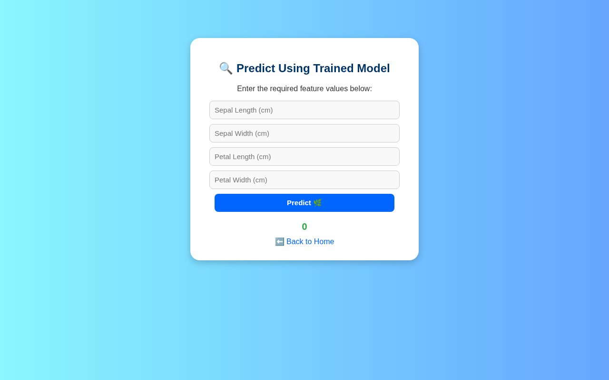
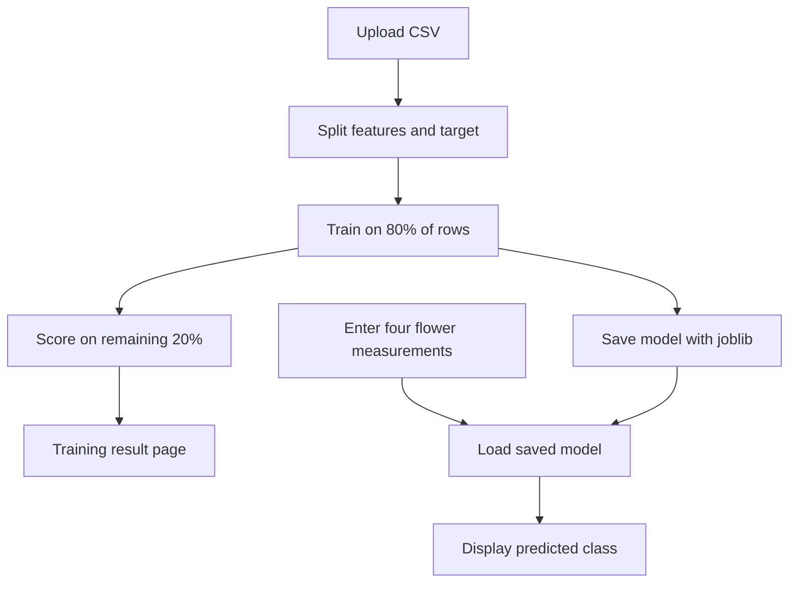

# CSV Classifier with Flask

Upload a CSV, train a random forest and use a web form to classify a new observation. The included example uses four flower measurements to predict a numeric species label.

## Local preview


The local Flask app accepted the sample CSV and returned class 0 for 5.1, 3.5, 1.4 and 0.2 in this run.



## Problem and goal

A training script alone makes it hard to see how a dataset becomes a usable prediction. This app puts training and inference behind two web forms. One upload trains a classifier, displays its holdout score and saves it for subsequent predictions.

## Workflow



## Languages, tools and APIs

Python and Flask handle HTTP requests. pandas reads the CSV, scikit-learn trains the RandomForestClassifier, and joblib persists it. Jinja HTML templates and CSS render the forms. The application uses local files for storage and inference.

| Route | Request and response |
| --- | --- |
| `GET /` | Shows the dataset upload page |
| `POST /upload` | Accepts a multipart field named `file`, trains the classifier and renders its holdout score |
| `GET /predict` | Shows the four-feature form |
| `POST /predict` | Converts form values to floats, loads the saved classifier and renders the predicted label |

## Try the sample in Windows PowerShell

```powershell
git clone https://github.com/Ashishkumar401/Cloud_AI_Deployment.git
Set-Location .\Cloud_AI_Deployment
py -3 -m venv .venv
.\.venv\Scripts\python.exe -m pip install -r requirements.txt
.\.venv\Scripts\python.exe app.py
```

Open `http://localhost:5000`, upload [the sample CSV](uploads/sample_dataset.csv), then open the prediction form. Try **5.1, 3.5, 1.4, 0.2** in order: sepal length, sepal width, petal length and petal width. The result is the class predicted by the most recently trained model.

## How training works

[The training function](train_auto.py) takes all columns except the last as features and the last column as the label. It holds out 20% of rows, fits a random forest and saves it to `models/model.pkl`. Each upload replaces that model. The [prediction form](templates/predict.html) expects four numeric inputs in the sample's column order.

The sample has ten rows, so the displayed accuracy comes from just two test examples and can change between runs. [Flask routes](app.py)

## Deployment status

The repository has no public homepage URL or GitHub deployment record. The screenshot above was captured on localhost. A separate hosted instance could not be verified.
